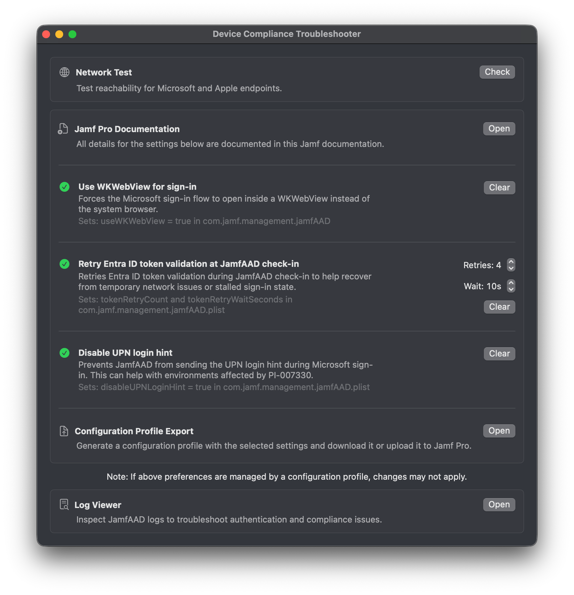
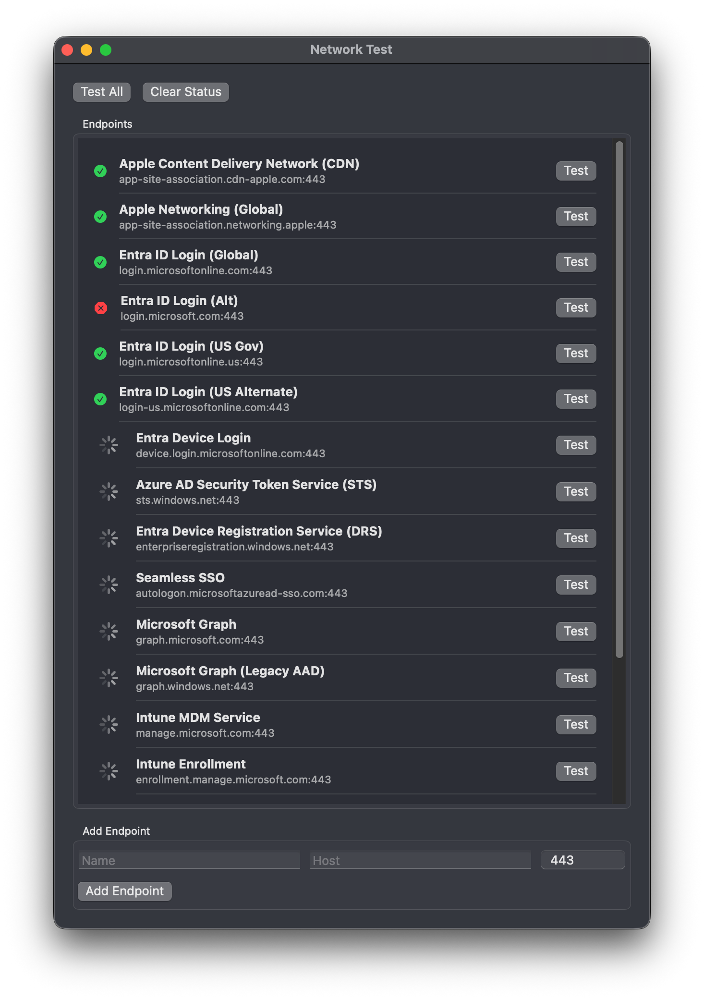
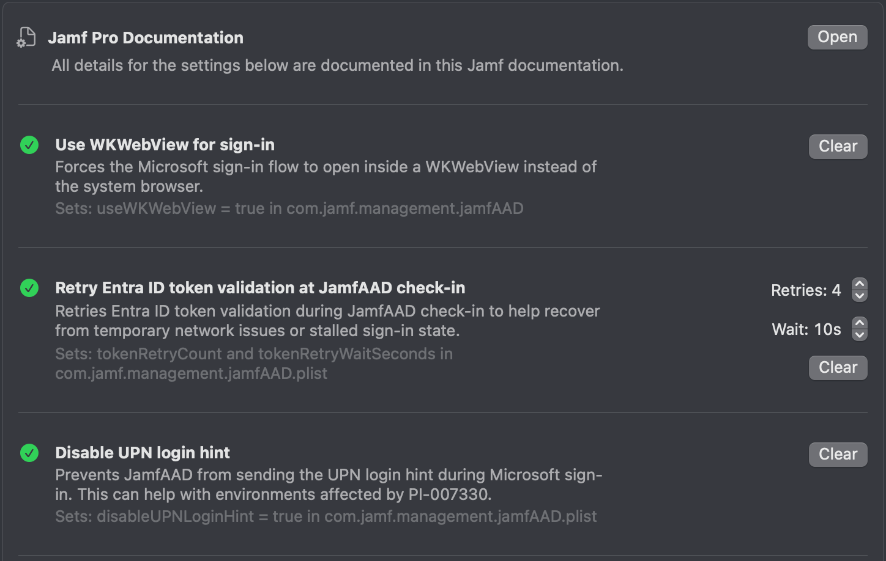
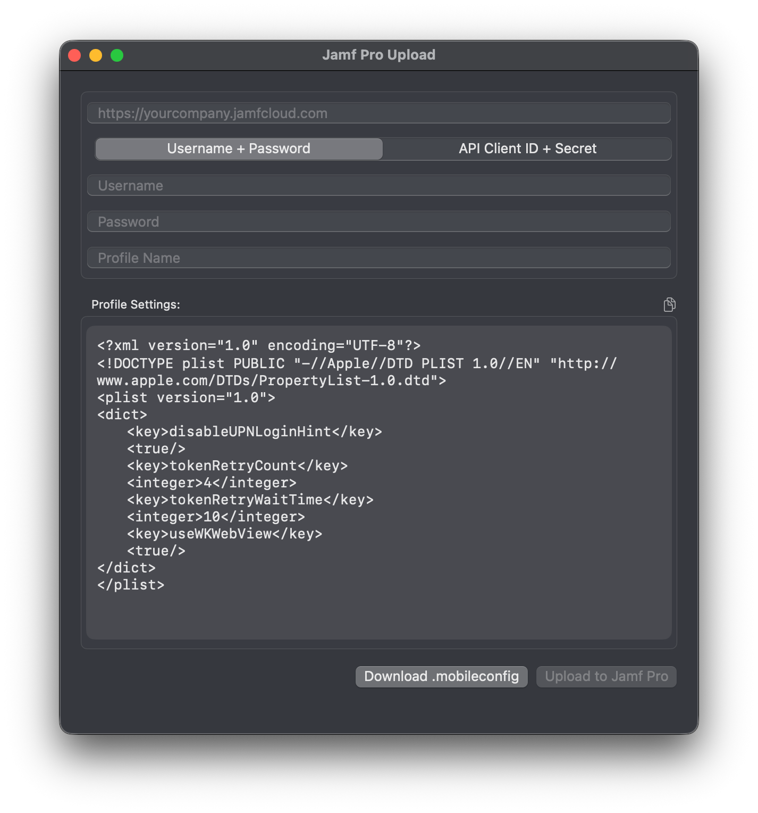
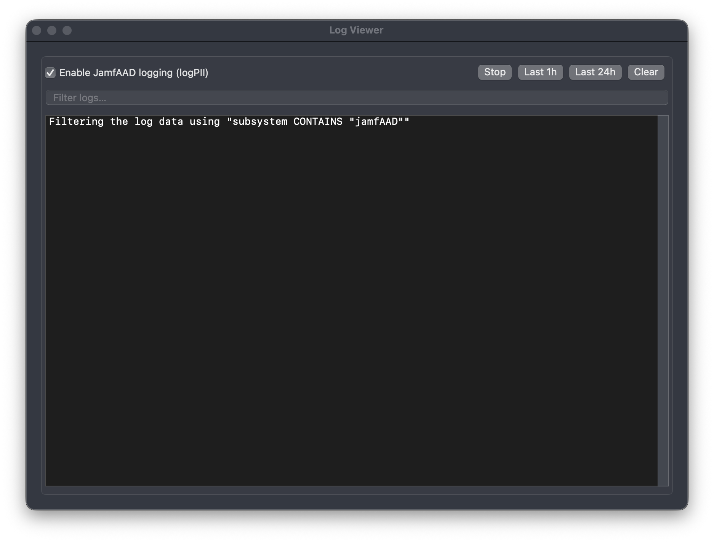

# Device Compliance Troubleshooter

[](https://github.com/Inetum-Poland/device-compliance-troubleshooter?tab=Apache-2.0-1-ov-file#)
[](#)
[](#)
[](https://github.com/Inetum-Poland/device-compliance-troubleshooter/releases)
[](#)

A macOS utility that makes troubleshooting **Jamf Pro ↔ Microsoft Entra ID (Intune) Device Compliance integration** significantly easier.

Instead of manually checking endpoints, tweaking hidden preferences, and digging through logs, this tool bundles the most common troubleshooting steps into a single interface.

Because sometimes the problem is complicated…  
**and sometimes it's just the network.**

---

# What This Tool Helps With

Troubleshooting **Jamf Pro Device Compliance with Microsoft Intune** usually looks like this:

1. Check if the **network is blocking something**
2. Apply **known fixes documented by Jamf**
3. Dive into **logs and hope they make sense**

This tool brings that workflow into one place and complements the official [Jamf documentation](https://learn.jamf.com/en-US/bundle/technical-paper-microsoft-intune-current/page/Creating_a_Policy_Directing_Users_to_Register_Mac_Computers_with_Azure_Active_Directory.html#task-99).



---

# When to Use This Tool

You should reach for Device Compliance Troubleshooter when:

- Users cannot complete **Entra ID (Azure AD) sign-in** during device registration
- You suspect **network restrictions** but want a quick and reliable way to verify required endpoints
- You want to quickly test **JamfAAD-related fixes** without manually modifying plists or profiles
- You need a fast way to **validate configuration changes locally** before deploying them at scale
- You want to generate and deploy a **configuration profile** based on working settings

### In short

If you're thinking:

> "Something is off… but I don't know where to start"

This tool gives you a **structured starting point**.

---

# Troubleshooting Workflow

## Network Test



The first and most common issue is **network restrictions**.

These can silently break communication with:

- Microsoft Entra ID
- Microsoft Graph
- Intune
- Device Registration Service
- Apple networking endpoints

The **Network Test** module performs quick connectivity checks against required endpoints.

### Example endpoints

```text
login.microsoftonline.com
graph.microsoft.com
manage.microsoft.com
enterpriseregistration.windows.net
device.login.microsoftonline.com
```

You can also **add custom endpoints** to match your environment.

Because if the network is broken, it's better to know immediately.

---

## Known Jamf Fixes



Jamf has identified several configuration tweaks that resolve common issues with Device Compliance authentication. These fixes are described in the official [Jamf documentation](https://learn.jamf.com/en-US/bundle/technical-paper-microsoft-intune-current/page/Creating_a_Policy_Directing_Users_to_Register_Mac_Computers_with_Azure_Active_Directory.html#task-99).

### Supported fixes

- **Use WKWebView for sign-in**
- **Retry token validation during JamfAAD check-in**
- **Disable UPN login hint**

Apply them locally with one click and validate immediately.

---

## Configuration Profile Management



Once you find a working setup:

- Generate a **configuration profile**
- Download it as `.mobileconfig`
- Upload it directly to **Jamf Pro via API**

No more manual profile building.

---

## Log Viewer



When everything else fails:

- Stream `jamfAAD` logs
- Search and filter logs
- Enable `logPII` for deeper debugging

### Reality check

`jamfAAD` is not very talkative.

But when you're **in a pinch**, even a single log line can be enough.

---

# Why This Exists

Troubleshooting Device Compliance usually means:

- jumping between documentation
- testing endpoints manually
- building configuration profiles
- parsing logs in Terminal
- questioning your life choices

This tool puts everything into **one place**.

---

# Disclaimer

This tool is **not an official Jamf product**.

Use at your own risk — but hopefully with much less frustration.

---

## Credits

Device Compliance Troubleshooter was created by the **Apple Business Unit** at **Inetum Polska Sp. z o.o.**

It is licensed under the [Apache License, version 2.0](https://www.apache.org/licenses/LICENSE-2.0).
